# 🏛️ MedCheck — Technical Architecture & ABDM Schema Specification
### **Altrix Labs AI Innovation Challenge • 24-Hour Hackathon Submission**
> *"MedCheck : an AI health copilot that explains medical records in your family’s language and flags medicine conflicts, without ever diagnosing."*

---

## 1. Executive Summary & System Overview

**MedCheck** is an AI health copilot built specifically for the family caregiver managing parents' healthcare across paper prescriptions, hospital discharge summaries, and lab reports. It bridges the critical divide between physical healthcare documents and patient safety by:

1. **Ingesting optical documents** (handwritten prescriptions, lab panels, discharge summaries).
2. **Comparing medicine documents** to highlight dosage shifts (+500mg), schedule changes, dropped medications, or duplicate blood thinners for a doctor or pharmacist to verify.
3. **Explaining medical jargon in regional languages** (Hindi, Telugu, Tamil, and English) with native Web Speech voice playback.
4. **Tracking longitudinal biomarkers** (HbA1c, Fasting Glucose, Cholesterol, BP, TSH, Vitamin D) across visits.
5. **Standardizing records into ABDM-compliant FHIR R4 bundles** with 14-digit mock ABHA IDs and LOINC codes.

---

## 2. 4-Member Engineering Ownership Matrix

| Member | Focus Area | Key Architectural Deliverables |
| :--- | :--- | :--- |
| **Member 1** | **AI / ML & Clinical OCR Lead** | Multimodal Vision Ingestion, OCR Preprocessing, Fuse.js Indian Drug Catalog Fuzzy Matcher, Zero-Guess Confidence Tiers (Green/Amber/Red) |
| **Member 2** | **Full-Stack & ABDM Architect** | Express API Gateway, Vite/React 19 SPA, ABDM FHIR R4 DocumentBundle Builder, LOINC Terminology Engine, ABHA Linking & Consent Simulator |
| **Member 3** | **Caregiver UX & Vernacular Lead** | Family Multi-Profile Hub (Papa, Maa, Self), Web Speech Regional Voice Engine (HI/TE/TA/EN), Jargon Simplifier, Mobile-Responsive Dashboard |
| **Member 4** | **Clinical Safety & Medicine Lead** | Medicine Document Conflict & Reconciliation Scanner, Printed-Range Normalization Engine, LASA Look-Alike Guardrails, Doctor Visit-Prep Generator |

---

## 3. Comprehensive Component Architecture

```mermaid
graph TB
    subgraph Client["Presentation & Client Layer (React 19 + Vite + Tailwind)"]
        UI_Dash["Family Health Dashboard (Papa / Maa / Self)"]
        UI_Conflict["Medicine Conflict Scanner (Document A vs B)"]
        UI_Verify["Verify Review Screen (Human-in-the-Loop)"]
        UI_Time["Longitudinal Records Timeline"]
        UI_Trend["Biomarker Recharts (Family-Specific)"]
        UI_Meds["Active Regimen & 14-Day Refill Alerts"]
        UI_Voice["Regional Voice Engine (Hindi/Telugu/Tamil/English)"]
        UI_Prep["Printable Doctor Visit-Prep Brief"]
        UI_ABHA["Mock ABHA ID & Consent Locker"]
        UI_Bench["Accuracy Benchmark Dashboard"]
        UI_Slides["8-Slide Pitch Deck (Team of 4)"]
    end

    subgraph Gateway["API & Middleware Layer (Node.js / Express)"]
        API_Upload["/api/upload (Multer Ingestion & Skew Normalization)"]
        API_FHIR["/api/fhir/validate (ABDM Bundle Validator)"]
        API_Health["/api/health (Service Discovery & Diagnostics)"]
    end

    subgraph ClinicalAI["Clinical Intelligence & Safety Engine"]
        OCR_Engine["Multimodal Vision OCR Engine"]
        Fuzzy_Engine["Fuse.js Indian Drug Catalog Matcher"]
        LASA_Guard["Look-Alike / Sound-Alike (LASA) Drug Safety Guard"]
        Printed_Range["Printed-Range Boundary Checker (Zero Hallucination)"]
        Conflict_Engine["Medicine Document Reconciliation Matrix"]
        Summary_Engine["Plain-Language Vernacular Health Summarizer"]
    end

    subgraph ABDM_Core["ABDM FHIR R4 Interoperability Standard"]
        Doc_Bundle["DocumentBundle (NRCeS StructureDefinition)"]
        Res_Patient["Patient Resource (14-Digit ABHA: 91-4589-2314-8702)"]
        Res_Obs["Observation Resources (LOINC: 4548-4, 1558-6, 2093-3)"]
        Res_Med["MedicationRequest Resources (DosageInstruction, Timing)"]
        Consent_Sim["ABDM Consent Artifact Simulator (HIP to HIU)"]
    end

    Client --> Gateway
    Gateway --> ClinicalAI
    ClinicalAI --> ABDM_Core
    ABDM_Core --> Client
```



---

## 4. End-to-End Data Pipeline Lifecycle

### Phase 1: Ingestion & Optical Conditioning
- Accepts mobile camera captures, multi-page clinical PDFs, and images (JPEG, PNG, WEBP).
- Skew correction, contrast enhancement, and noise reduction ensure cursive doctor handwriting and faded thermal lab printouts remain legible.

### Phase 2: Multimodal Extraction & Zero-Guess Confidence Tiers
- Extracted entities are classified into three strict confidence tiers:
  - 🟢 **Green (High Confidence):** Legible print, verified matches.
  - 🟡 **Amber (Check Required):** Cursive/faded handwriting; fuzzy matched against the Indian Drug Catalog to offer candidate suggestions.
  - 🔴 **Red (Unreadable / Low Confidence):** Zero-guess protocol; unreadable lines are NEVER guessed or hallucinated by the model. Prompts user manual entry.

### Phase 3: Medicine Document Conflict & Reconciliation Scanner
- When a family caregiver uploads or selects two documents (e.g. a recent Hospital Discharge Summary vs an earlier Clinic Prescription):
  - **Cross-matches** all prescribed medications by generic chemical entity.
  - **Detects dose discrepancies:** e.g., Metformin 1000mg BID vs 500mg BID (+100% dose jump).
  - **Detects timing shifts:** e.g., Before meals vs After meals.
  - **Detects duplicate therapies / dangerous combinations:** e.g., Clopidogrel added while Aspirin still active.
  - **Generates targeted doctor questions:** Formatted for WhatsApp or clinic printout with regional voice pronunciation.

### Phase 4: Printed-Range Only Boundary Verification
- Lab values (e.g. HbA1c 8.2%, Fasting Glucose 142 mg/dL) are evaluated **STRICTLY against the reference ranges printed on that specific physical laboratory report**, eliminating model memory hallucinations.

### Phase 5: ABDM FHIR R4 Standardization
The internal normalized JSON is assembled into an official ABDM FHIR R4 `DocumentBundle`:

```json
{
  "resourceType": "Bundle",
  "id": "bundle-MEDCHECK-PAPA-2026-10-02",
  "meta": {
    "profile": [
      "https://nrces.in/ndhm/fhir/r4/StructureDefinition/DocumentBundle"
    ]
  },
  "type": "document",
  "timestamp": "2026-10-02T10:30:00Z",
  "entry": [
    {
      "fullUrl": "urn:uuid:patient-FAM-PAPA-62",
      "resource": {
        "resourceType": "Patient",
        "id": "FAM-PAPA-62",
        "identifier": [
          {
            "system": "https://healthid.ndhm.gov.in",
            "value": "91-4589-2314-8702"
          }
        ],
        "name": [{ "text": "Ramesh Sharma" }],
        "gender": "male",
        "birthDate": "1964-05-12"
      }
    },
    {
      "fullUrl": "urn:uuid:obs-hba1c-20261002",
      "resource": {
        "resourceType": "Observation",
        "id": "obs-hba1c",
        "status": "final",
        "code": {
          "coding": [
            {
              "system": "http://loinc.org",
              "code": "4548-4",
              "display": "Hemoglobin A1c/Hemoglobin.total in Blood"
            }
          ]
        },
        "subject": { "reference": "urn:uuid:patient-FAM-PAPA-62" },
        "valueQuantity": {
          "value": 8.2,
          "unit": "%",
          "system": "http://unitsofmeasure.org",
          "code": "%"
        },
        "referenceRange": [
          {
            "high": { "value": 5.7, "unit": "%" },
            "text": "< 5.7 % (Normal), >= 6.5 % (Diabetic)"
          }
        ],
        "interpretation": [
          {
            "coding": [{ "system": "http://terminology.hl7.org/CodeSystem/v3-ObservationInterpretation", "code": "H", "display": "High" }]
          }
        ]
      }
    },
    {
      "fullUrl": "urn:uuid:med-metformin-1000",
      "resource": {
        "resourceType": "MedicationRequest",
        "id": "med-metformin",
        "status": "active",
        "intent": "order",
        "medicationCodeableConcept": {
          "text": "Tab Metformin HCl 1000mg"
        },
        "dosageInstruction": [
          {
            "text": "1 tablet twice daily after meals (भोजन के बाद)",
            "timing": {
              "repeat": { "frequency": 2, "period": 1, "periodUnit": "d" }
            }
          }
        ]
      }
    }
  ]
}
```

---

## 5. Security, Privacy & Zero-Diagnosis Guardrails

1. **Client-Side First De-Identification:** Patient Identifiable Information (PII) is de-identified on the client prior to any cloud extraction inference.
2. **Zero-Diagnosis Assurance:** The copilot strictly synthesizes explanations and formulates doctor questions; it explicitly avoids diagnosing conditions or initiating drug modifications.
3. **ABDM Sandbox Ready:** Features mock Aadhaar OTP verification, HIU consent artifact management, and 1-click JSON bundle export.
